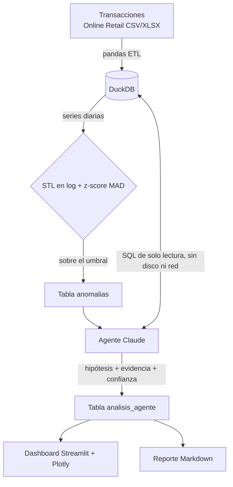

# Datawatch Enterprise 2025

**Datawatch** vigila las métricas diarias de un e-commerce: ventas, órdenes,
ticket promedio y unidades. Cuando una se sale de lo esperable, un agente de
Claude investiga la causa consultando la base de datos con SQL de solo
lectura, y deja una hipótesis con su evidencia y su nivel de confianza.

La detección es estadística y determinista: descomposición STL más z-score
robusto con MAD. El modelo de lenguaje solo entra a explicar lo que la
estadística ya marcó, y no puede tocar la base.

## Arquitectura



| Módulo | Qué hace |
|---|---|
| `src/data/ingest.py` | Transacciones a métricas diarias. Excluye anulaciones (facturas con C), devoluciones y precios cero. La carga es idempotente (upsert). |
| `src/data/detect.py` | STL sobre el logaritmo de cada serie, en días hábiles, y z-score con MAD sobre el residuo. |
| `src/ai/tools.py` | Sandbox SQL del agente. |
| `src/ai/investigator.py` | Bucle de herramientas con Claude y veredicto en salida estructurada (Pydantic). |
| `src/ui/dashboard.py` | KPIs, serie con las anomalías marcadas y las explicaciones del agente. |
| `src/reporte.py` | Reporte Markdown de la última corrida. |
| `evals/benchmark.py` | Recall del detector con anomalías inyectadas. |

## Empezar

Requiere [uv](https://docs.astral.sh/uv/).

```bash
make setup     # instala dependencias
make demo      # genera datos sintéticos y corre el pipeline, sin descargar nada
make dashboard # abre el dashboard en http://localhost:8501
```

Con datos reales:

1. Descarga **Online Retail**, de
   [UCI](https://archive.ics.uci.edu/dataset/352/online+retail)
   (`Online Retail.xlsx`) o de
   [Kaggle](https://www.kaggle.com/datasets/carrie1/ecommerce-data)
   (`data.csv`), y déjalo en `data/`.
2. Copia `.env.example` a `.env`. Pon la ruta del archivo en
   `DATAWATCH_DATA_PATH` y tu `ANTHROPIC_API_KEY`.
3. Corre `make run` y después `make dashboard`.

Sin `ANTHROPIC_API_KEY`, el pipeline corre igual (ingesta, detección y
reporte) y se salta el agente.

| Variable | Por omisión | |
|---|---|---|
| `ANTHROPIC_API_KEY` | — | Clave de la API de Claude. |
| `DATAWATCH_CLAUDE_MODEL` | `claude-opus-5-5` | Modelo del agente. |
| `DATAWATCH_CLAUDE_EFFORT` | `high` | Esfuerzo de razonamiento. |
| `DATAWATCH_DATA_PATH` | `data/OnlineRetail.xlsx` | Archivo de transacciones. |
| `DATAWATCH_UMBRAL_ANOMALIA` | `3.5` | z-score robusto desde el que se marca una anomalía. |

Las variables llevan el prefijo `DATAWATCH_` para no chocar con otras del
entorno. Sin él, el proyecto tomaba la `CLAUDE_EFFORT` que define Claude
Code en su terminal.

## Detección: qué tan bien funciona

Medido con los datos sintéticos de `make demo`: 311 días, con tres
anomalías plantadas (un pedido mayorista, una caída del sitio y un error de
precios).

| Configuración | Avisos sin causa | Plantadas encontradas |
|---|---|---|
| Como el script original (STL con ventanas de omisión, sin log, umbral 3,0), ya con el período corregido | 108 | 3 de 3 |
| STL en log, estacionalidad 13, tendencia 31, umbral 3,0 | 16 | 3 de 3 |
| Igual, umbral 3,5 (por omisión) | 10 | 3 de 3 |

`make benchmark` inyecta una anomalía por prueba, en una copia en memoria
(nunca en la base), y mide el recall por magnitud. Son 40 pruebas por
magnitud, con el umbral 3,5:

| Magnitud | ×0,5 | ×0,7 | ×1,3 | ×1,5 | ×2 | ×3 |
|---|---|---|---|---|---|---|
| Recall | 72 % | 38 % | 0 % | 45 % | 72 % | 100 % |

Un pico del triple se detecta siempre. Una variación del 30 % no se
distingue del ruido diario. Es el límite honesto de un detector por serie
y sin contexto, y es la razón de tener al agente: cruzar métricas y fechas
es lo que la estadística por serie no hace.

## Seguridad del agente

El agente solo puede ejecutar SQL a través de `SQLSandbox`, que tiene tres
capas:

1. **El parser de DuckDB.** Exige exactamente una sentencia, y que sea de
   tipo SELECT. Una expresión regular sobre el texto se engaña con
   comentarios; el parser no.
2. **Una lista de palabras prohibidas.** Es un respaldo. Con el parser
   funcionando es redundante: sacarla no hace caer ninguna prueba.
3. **Una conexión de solo lectura sin acceso a archivos ni red**
   (`enable_external_access = false`, bloqueado con `lock_configuration`).
   Es la capa que impide `SELECT * FROM read_text('/etc/passwd')`, que pasa
   las otras dos porque *es* un SELECT.

Además, toda consulta se envuelve en un `LIMIT 50`, y el resultado se corta
en 6.000 caracteres antes de volver al modelo.

## Pruebas

```bash
make test       # 23 pruebas, sin API: el agente se prueba con un cliente falso
make lint
make benchmark
```

Cada prueba se midió poniendo el defecto a mano y confirmando que la prueba
falla. La medición está escrita en el encabezado de cada archivo de
pruebas. El CI (`.github/workflows/ci.yml`) corre lint, formato y pruebas
en cada push.

## Lo que falta

- **Una corrida del agente con la API real.** La llamada se probó contra un
  servidor falso local (forma de la petición, bucle de herramientas y
  veredicto estructurado), pero no con la API de Claude.
- **Una corrida con el dataset real.** Los números de arriba son de datos
  sintéticos. El dataset real tiene más ruido, y conviene correr
  `make benchmark` sobre él antes de confiar en el umbral.
